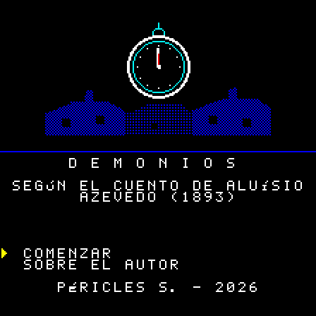
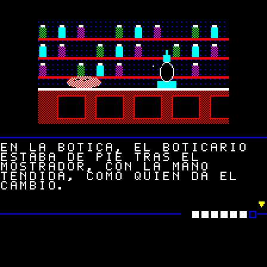
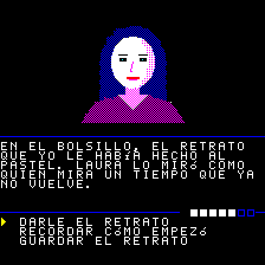

# Demônios

[English](README.md) · [Português](README.pt-BR.md) · **Español**

Aventura de texto ilustrada para la **Casio PV-1000** (1983), basada en el cuento
*Demônios* ("Demonios", 1893) del escritor brasileño **Aluísio Azevedo**. Escrita en Z80
puro, cabe en un cartucho de 32 KB sin mapper.

  
  
  
  

## Descarga

Las ROMs están en las [releases](https://github.com/PSGM-Romhacking/pv-1000_demonios/releases), una por idioma, comprimidas con el nombre al
estilo No-Intro:

| Archivo | Tamaño | CRC32 | SHA-1 |
|---|---|---|---|
| `Demonios (World) (Pt) (Aftermarket) (Unl).bin` | 32 KB | `b87e2293` | `48cfb336f878da078e21d3f3caad838dfdd64a3d` |
| `Demonios (World) (En) (Aftermarket) (Unl).bin` | 32 KB | `b0b1390b` | `4a26bfaea79585d816b62534b13fae7c4548e6e8` |
| `Demonios (World) (Es) (Aftermarket) (Unl).bin` | 32 KB | `7f8f2ccf` | `3a23595778c8ea1359c7d7a6f5213020119b1854` |

Para traducirlo a otro idioma, vea [idiomas](docs/technical.es.md#idiomas).

## El juego

Un escritor despierta en mitad de la noche y se da cuenta de que el día no va a llegar.
Sale a un Río de Janeiro muerto y silencioso para encontrar a Laura. Poco a poco, los dos
pierden lo que los hace humanos.

- **41 escenas, 15 ilustraciones y 7 finales**, en tres rutas que se separan a mitad de
  camino.
- Música solo en el título y en las pantallas finales. La historia es en silencio.
- En el título, **"Sobre el autor"** muestra un retrato y una biografía corta de Aluísio
  Azevedo.

El texto es una adaptación condensada del original y mantiene lo grotesco del cuento
(descomposición, cadáveres, la transformación física).

### Cómo funciona

**La pantalla.** Arriba, la ilustración. En el medio, una línea con la barra de humanidad
a la derecha. Debajo, el texto de la escena; un **▼** en la esquina indica que hay otra
página (Fire 1 avanza). Abajo, las opciones: elija con arriba/abajo y confirme con
Fire 1. No hay tiempo, ni combate, ni comandos equivocados: todo se decide en las
elecciones.

**Humanidad (la barra).** Lo que aún queda del narrador. Empieza llena, con 7 bloques, y
**nunca sube**. Baja:
- cuando usted huye, espera, se aísla o actúa con egoísmo;
- cuando anda por un lugar oscuro sin luz;
- en algunos momentos de la historia que usted no controla.

Algunas elecciones de cuidado (recordar, compartir, acompañar) **protegen**: la próxima
pérdida no ocurre. A medida que la barra baja, el juego cambia:

| Humanidad | Qué pasa |
|---|---|
| 5 a 7 | todo normal |
| 3 a 4 | el texto se encoge: solo la primera frase de cada página |
| 1 a 2 | la barra se pone roja; el texto pierde la puntuación y las palabras pequeñas, y el narrador olvida objetos que llevaba |
| 0 | la historia termina ahí |

**Lazo (oculto).** El afecto entre el narrador y Laura. No aparece en pantalla: se nota en
lo que ella dice y en lo que deja de decir. Sube cuando usted va hacia ella, la escucha y
la cuida; baja cuando se desvía, miente o la deja de lado. Junto con la humanidad, decide
**adónde va la historia y qué final verá**.

**Objetos.** Fire 2 abre el inventario. En el camino hay que elegir qué llevar o dejar, a
veces una cosa u otra. Un objeto puede abrir un paso, cambiar una escena o ahorrar
humanidad; ninguno es obligatorio.

**Oscuridad.** Sin luz, la ilustración aparece solo en contornos azules y la escena cuesta
humanidad. Una luz que usted lleve lo evita.

**Finales.** Son 7, de buenos a malos, en tres rutas. Al terminar, el juego muestra el
nombre del final y cuántos ha visto ("Finales vistos: 2/7"); el título también. No hay
contraseña ni batería: la cuenta vale mientras la consola esté encendida. El juego es
corto y todos los finales se pueden alcanzar desde la primera partida.

## Jugar

Abra la ROM en un emulador de Casio PV-1000.

| Botón | Acción |
|---|---|
| arriba / abajo | elegir |
| **Fire 1** | confirmar, avanzar |
| **Fire 2** | inventario |
| **Start** | pausa |

En el título, **Comenzar** inicia el juego y **Sobre el autor** muestra la biografía de
Aluísio Azevedo. El inventario (Fire 2) muestra lo que lleva el narrador; Fire 1 o 2 lo
cierra. La pausa (Start) permite continuar o volver al título. En la pantalla final,
cuando termina la música, cualquier botón vuelve al título.

## En la consola original

El juego solo usa lo que la Casio PV-1000 trae de fábrica: cartucho de 32 KB sin mapper, sin
batería y sin chip extra. Grabado en un cartucho, debería funcionar en la consola real,
pero aún no se ha probado así: los informes son bienvenidos.

## Haga su propia versión

Todo se genera a partir de archivos de texto: el guion en YAML, las imágenes dibujadas por
código y la música escrita en notas. Se puede corregir el texto, traducirlo a otro idioma
o cambiar toda la historia y compilar una ROM nueva. Cómo hacerlo:
[docs/technical.es.md](docs/technical.es.md).

## Créditos y licencia

- **Cuento original:** *Demônios*, de Aluísio Azevedo (1893), de dominio público. Texto
  base: [Wikisource](https://pt.wikisource.org/wiki/Dem%C3%B4nios_(Alu%C3%ADsio_Azevedo)).
- **Retrato del autor:** fotografía anterior a 1913, de dominio público; archivo de la
  [Academia Brasileira de Letras](https://www.academia.org.br/).
- **Juego:** Péricles S., 2026.

- **Código** (`src/rom/`, `src/tools/`, `Makefile`): [GPL-3.0](LICENSE).
- **Contenido** (guion, traducciones e imágenes): [CC BY-NC-SA 4.0](LICENSE-CONTENT).

El cuento original es de dominio público; la licencia cubre solo esta adaptación.

## Contacto

romhacking@psgm.com.br
