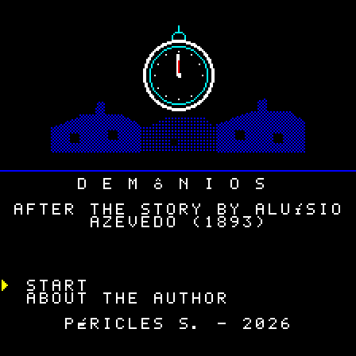
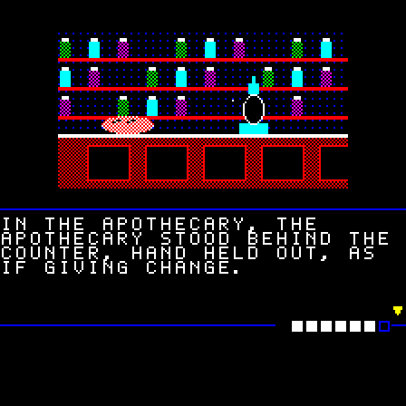
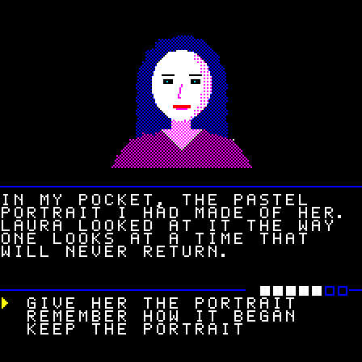

# Demônios

**English** · [Português](README.pt-BR.md) · [Español](README.es.md)

An illustrated text adventure for the **Casio PV-1000** (1983), based on the short story
*Demônios* ("Demons", 1893) by Brazilian writer **Aluísio Azevedo**. Written in plain Z80,
it fits a 32 KB cartridge with no mapper.

  
  
  
  

## Download

The ROMs are in the [releases](https://github.com/PSGM-Romhacking/pv-1000_demonios/releases), one per language, zipped under their No-Intro-style
names:

| File | Size | CRC32 | SHA-1 |
|---|---|---|---|
| `Demonios (World) (Pt) (Aftermarket) (Unl).bin` | 32 KB | `b87e2293` | `48cfb336f878da078e21d3f3caad838dfdd64a3d` |
| `Demonios (World) (En) (Aftermarket) (Unl).bin` | 32 KB | `b0b1390b` | `4a26bfaea79585d816b62534b13fae7c4548e6e8` |
| `Demonios (World) (Es) (Aftermarket) (Unl).bin` | 32 KB | `7f8f2ccf` | `3a23595778c8ea1359c7d7a6f5213020119b1854` |

To translate it into another language, see [languages](docs/technical.md#languages).

## The game

A writer wakes up in the middle of the night and realizes the day will not come. He walks
out into a dead, silent Rio de Janeiro to find Laura. Little by little, both of them lose
what makes them human.

- **41 scenes, 15 illustrations and 7 endings**, along three routes that split halfway.
- Music only on the title and ending screens. The story is silent.
- On the title screen, **"About the author"** shows a portrait and a short biography of
  Aluísio Azevedo.

The text is a condensed adaptation of the original and keeps the story's grotesque
(decay, corpses, the physical transformation).

### How it works

**The screen.** The picture is at the top. In the middle, a line with the humanity bar on
the right. Below it, the scene's text; a **▼** in the corner means there is another page
(Fire 1 turns it). At the bottom, the choices: pick with up/down and confirm with Fire 1.
There is no timer, no combat and no wrong command: everything is decided by your choices.

**Humanity (the bar).** How much of the narrator is left. It starts full, with 7 blocks,
and **never goes up**. It drops:
- when you run away, wait, shut yourself off or act selfishly;
- when you walk through a dark place without a light;
- at some points in the story that you don't control.

Some caring choices (remembering, sharing, staying close) **protect** you: the next loss
doesn't happen. As the bar goes down, the game changes:

| Humanity | What happens |
|---|---|
| 5 to 7 | everything is normal |
| 3 to 4 | the text shrinks: only the first sentence of each page |
| 1 to 2 | the bar turns red; the text loses its punctuation and the small words, and the narrator forgets things he carried |
| 0 | the story ends there |

**Bond (hidden).** The affection between the narrator and Laura. It is not shown on
screen: you notice it in what she says, and in what she stops saying. It goes up when you
go to her, listen and take care of her; it goes down when you turn away, lie or leave her
aside. Together with humanity, it decides **where the story goes and which ending you
get**.

**Items.** Fire 2 opens the inventory. Along the way you choose what to take or leave,
sometimes one thing or the other. An item may open a way, change a scene or spare your
humanity; none is required.

**Darkness.** Without a light, the picture shows only blue outlines and the scene costs
humanity. A light you carry prevents that.

**Endings.** There are 7, from good to bad, across three routes. When you finish, the
game shows the ending's name and how many you have seen ("Endings seen: 2/7"); so does
the title screen. There is no password and no battery: the count lasts while the console
is on. The game is short, and every ending can be reached from the first playthrough.

## Playing

Open the ROM in a Casio PV-1000 emulator.

| Button | Action |
|---|---|
| up / down | choose |
| **Fire 1** | confirm, next |
| **Fire 2** | inventory |
| **Start** | pause |

On the title screen, **Start** begins the game and **About the author** shows Aluísio
Azevedo's biography. The inventory (Fire 2) lists what the narrator carries; Fire 1 or 2
closes it. The pause menu (Start) lets you continue or go back to the title. On the ending
screen, once the music is over, any button goes back to the title.

## On the original console

The game only uses what the Casio PV-1000 has out of the box: a 32 KB cartridge with no mapper,
no battery and no extra chip. Written to a cartridge, it should run on the real console,
but it hasn't been tested that way yet: reports are welcome.

## Make your own version

Everything is generated from text files: the script in YAML, the images drawn by code
and the music written as notes. You can fix the text, translate it into another language
or replace the whole story and build a new ROM. How to do it:
[docs/technical.md](docs/technical.md).

## Credits and license

- **Original story:** *Demônios* by Aluísio Azevedo (1893), public domain. Source text:
  [Wikisource](https://pt.wikisource.org/wiki/Dem%C3%B4nios_(Alu%C3%ADsio_Azevedo)).
- **Author's portrait:** a photograph from before 1913, public domain; file from the
  [Academia Brasileira de Letras](https://www.academia.org.br/).
- **Game:** Péricles S., 2026.

- **Code** (`src/rom/`, `src/tools/`, `Makefile`): [GPL-3.0](LICENSE).
- **Content** (script, translations and images): [CC BY-NC-SA 4.0](LICENSE-CONTENT).

The original story is in the public domain; the license covers only this adaptation.

## Contact

romhacking@psgm.com.br
