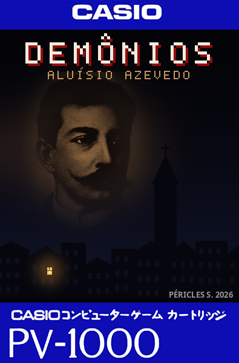
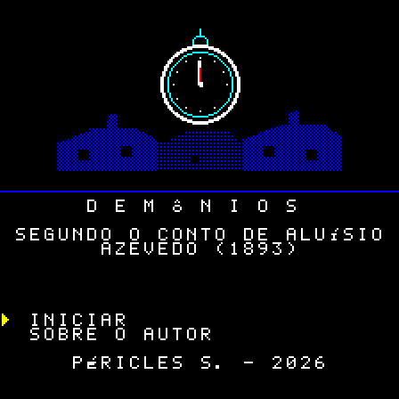
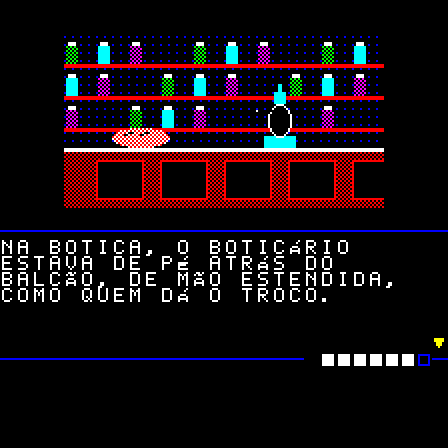
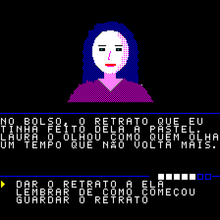

# Demônios

[English](README.md) · **Português** · [Español](README.es.md)

Aventura de texto ilustrada para o **Casio PV-1000** (1983), baseada no conto
*Demônios* (1893), de **Aluísio Azevedo**. Escrita em Z80 puro, cabe num cartucho de
32 KB sem mapper.

  
  
  
  

## Download

As ROMs estão nas [releases](https://github.com/PSGM-Romhacking/pv-1000_demonios/releases), uma por língua, zipadas com o nome no padrão
No-Intro:

| Arquivo | Tamanho | CRC32 | SHA-1 |
|---|---|---|---|
| `Demonios (World) (Pt) (Aftermarket) (Unl).bin` | 32 KB | `b87e2293` | `48cfb336f878da078e21d3f3caad838dfdd64a3d` |
| `Demonios (World) (En) (Aftermarket) (Unl).bin` | 32 KB | `b0b1390b` | `4a26bfaea79585d816b62534b13fae7c4548e6e8` |
| `Demonios (World) (Es) (Aftermarket) (Unl).bin` | 32 KB | `7f8f2ccf` | `3a23595778c8ea1359c7d7a6f5213020119b1854` |

Para traduzir para outra língua, veja [línguas](docs/technical.pt-BR.md#línguas).

## O jogo

Um escritor acorda no meio da noite e percebe que o dia não vai nascer. Sai pelo Rio de
Janeiro morto e silencioso para encontrar Laura. Os dois vão perdendo, pouco a pouco, o
que os faz humanos.

- **41 cenas, 15 ilustrações e 7 finais**, em três rotas que se separam a meio caminho.
- Música só no título e nas telas de fim. A história é em silêncio.
- No título, **"Sobre o autor"** mostra o retrato e uma biografia curta de Aluísio Azevedo.

O texto é uma adaptação condensada do original e mantém o grotesco do conto
(decomposição, corpos, a transformação física).

### Como funciona

**A tela.** Em cima, a ilustração. No meio, uma linha com a barra de humanidade à direita.
Depois, o texto da cena; um **▼** no canto quer dizer que há mais página (Fire 1 avança).
Embaixo, as opções: escolha com cima/baixo e confirme com Fire 1. Não há tempo correndo,
nem combate, nem como errar um comando: tudo se decide nas escolhas.

**Humanidade (a barra).** É o quanto ainda resta do narrador. Começa cheia, com 7
quadrados, e **nunca sobe**. Cai:
- quando você foge, espera, se isola ou faz algo egoísta;
- quando anda por um lugar escuro sem luz;
- em alguns momentos da história, que você não controla.

Algumas escolhas de cuidado (lembrar, repartir, acompanhar) **protegem**: a próxima perda
não acontece. Conforme a barra desce, o jogo muda:

| Humanidade | O que acontece |
|---|---|
| 5 a 7 | tudo normal |
| 3 a 4 | o texto encolhe: só a primeira frase de cada página |
| 1 a 2 | a barra fica vermelha; o texto perde a pontuação e as palavras pequenas, e o narrador esquece objetos que carregava |
| 0 | a história termina ali |

**Laço (escondido).** O afeto entre o narrador e Laura. Não aparece na tela: você o
percebe pelo que ela diz e pelo que ela deixa de dizer. Sobe quando você vai até ela,
escuta e cuida; desce quando você desvia, mente ou a deixa de lado. É ele, junto com a
humanidade, que decide **para onde a história vai e qual final você vê**.

**Objetos.** Fire 2 abre o inventário. Pelo caminho há escolhas de levar ou deixar, às
vezes uma coisa ou outra. Um objeto pode abrir uma passagem, mudar uma cena ou poupar
humanidade; nenhum é obrigatório.

**Escuro.** Sem luz, a ilustração aparece só em contornos azuis e a cena custa
humanidade. Uma luz que você carregue evita isso.

**Finais.** São 7, de bons a ruins, em três rotas. Ao terminar, o jogo mostra o nome do
final e quantos você já viu ("Finais vistos: 2/7"); o título também. Não há senha nem
bateria: a contagem vale enquanto o console estiver ligado. O jogo é curto, e todos os
finais podem ser alcançados desde a primeira partida.

## Jogar

Abra a ROM num emulador de Casio PV-1000.

| Botão | Ação |
|---|---|
| cima / baixo | escolher |
| **Fire 1** | confirmar, avançar |
| **Fire 2** | inventário |
| **Start** | pausa |

No título, **Iniciar** começa o jogo e **Sobre o autor** mostra a biografia de Aluísio
Azevedo. O inventário (Fire 2) lista o que o narrador carrega; Fire 1 ou 2 fecha. A pausa
(Start) deixa continuar ou voltar ao título. Na tela de fim, depois da música, qualquer
botão volta ao título.

## No console original

O jogo só usa o que o Casio PV-1000 tem de fábrica: cartucho de 32 KB sem mapper, sem bateria e
sem chip extra. Gravado num cartucho, deve rodar no console de verdade, mas ainda não foi
testado assim: relatos são bem-vindos.

## Faça a sua versão

Tudo é gerado a partir de arquivos de texto: o roteiro em YAML, as imagens desenhadas por
código e as músicas escritas em notas. Dá para corrigir o texto, traduzir para outra
língua ou trocar a história inteira e montar uma ROM nova. Como fazer:
[docs/technical.pt-BR.md](docs/technical.pt-BR.md).

## Créditos e licença

- **Conto original:** *Demônios*, de Aluísio Azevedo (1893), em domínio público.
  Texto-base: [Wikisource](https://pt.wikisource.org/wiki/Dem%C3%B4nios_(Alu%C3%ADsio_Azevedo)).
- **Retrato do autor:** fotografia de antes de 1913, em domínio público; arquivo da
  [Academia Brasileira de Letras](https://www.academia.org.br/).
- **Jogo:** Péricles S., 2026.

- **Código** (`src/rom/`, `src/tools/`, `Makefile`): [GPL-3.0](LICENSE).
- **Conteúdo** (roteiro, traduções e imagens): [CC BY-NC-SA 4.0](LICENSE-CONTENT).

O conto original é de domínio público; a licença cobre só esta adaptação.

## Contato

romhacking@psgm.com.br
